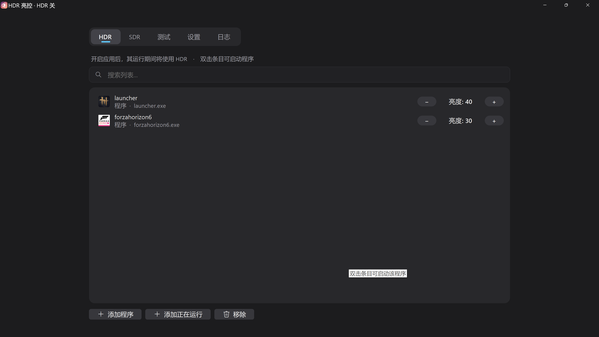

# HDR 亮控 (HdrBrightControl)

## ✨ 功能特性

- **自动 HDR 切换**：前台运行指定程序时自动开启/关闭 HDR
- **电视亮度控制**：仅适用于 LG webOS 系统（已在 LG G6 验证）

## 📸 界面截图

### 设置页面

### HDR 页面

## 📥 下载

前往 [GitHub Releases](https://github.com/HdrBrightControl/HdrBrightControl/releases) 下载最新版本的编译好的软件，解压后直接运行即可。
