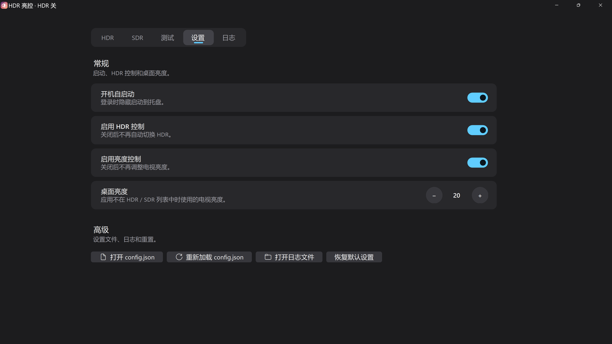

# HDR 亮控 (HdrBrightControl)

## ✨ 功能特性

- **自动 HDR 切换**：前台运行指定程序时自动开启/关闭 HDR
- **电视亮度控制**：仅适用于 LG webOS 系统（已在 LG G6 验证）



## 🚀 快速开始

### 编译

```powershell
& "C:\Users\admin\.dotnet\dotnet.exe" build HdrBrightControl.csproj -c Release
```

### 输出位置

`bin\Release\net10.0-windows\win-x64\publish\HdrBrightControl.exe`
